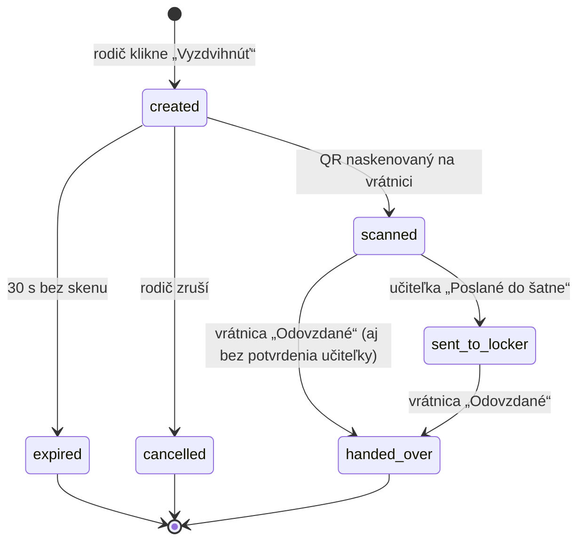

# Špecifikácia: aplikácia na vyzdvihovanie detí (MŠ / ZŠ / SKD)

> **Pracovný názov:** BodyGuard (názov držať na jednom mieste v konfigurácii; po zistení dostupnosti domény sa môže zmeniť)
> **Pre:** Claude Code. Tento dokument je zdroj pravdy pre zadanie. Pred implementáciou si prečítaj celý dokument, navrhni plán a polož otázky k sekcii „Otvorené otázky“.

---

## 1. Cieľ

Zrýchliť a zbezpečniť vyzdvihovanie detí zo škôlky, školy alebo školského klubu (SKD) a odľahčiť recepciu/vrátnicu.

**Ako to funguje v skratke:**
1. Rodič (alebo schválený člen rodiny) príde ku škole, v aplikácii klikne **„Vyzdvihnúť [meno dieťaťa]“**.
2. Aplikácia vygeneruje **jednorazový QR kód platný 30 sekúnd**.
3. Na vrátnici ho naskenuje čítačka (tablet kamerou alebo ESP32 čítačka).
4. Učiteľky, ktoré majú dieťa na starosti, dostanú **notifikáciu**, kliknú **„Poslané do šatne“**.
5. Vrátnička vizuálne overí rodiča a dieťa a klikne **„Odovzdané“**.
6. Každý krok sa zapíše s časom a osobou; mesačne sa generuje **Excel report**.

Celá dôvera v systéme stojí na škole: **účty schvaľuje škola, nie anonymná registrácia.**

---

## 2. Odporúčaný tech stack

| Vrstva | Technológia | Poznámka |
|---|---|---|
| Frontend | Next.js (App Router, TypeScript) ako **PWA** | Hosting na **Vercel** |
| Auth | Firebase Authentication | E-mail + overenie telefónu (SMS) |
| Databáza | Cloud Firestore | Región **EÚ** (`eur3` alebo `europe-west`) kvôli GDPR |
| Backend logika | Firebase Cloud Functions (TypeScript) | Generovanie/validácia QR, routing notifikácií, reporty |
| Push notifikácie | Firebase Cloud Messaging (FCM) | Web push |
| Súbory | Firebase Storage | Fotky profilov, vygenerované reporty |
| Excel | `exceljs` v Cloud Function | |
| Hardvér (voliteľné) | ESP32 + QR čítačka | Posiela naskenovaný token na HTTPS endpoint |
| Platby (neskôr) | Stripe | Predplatné pre inštitúciu |
| UI jazyk | Slovenčina (pripraviť i18n pre ďalšie jazyky) | |

> **Pozor na iOS:** web push na iPhone funguje len ak je PWA pridaná na plochu (iOS 16.4+). Pre učiteľky je spoľahlivá notifikácia kritická. V otvorených otázkach je rozhodnutie, či neskôr spraviť natívnu appku (napr. Expo / React Native).

---

## 3. Roly a oprávnenia

### 3.1 Roly v inštitúcii (priraďuje riaditeľ)

| Rola | Kód | Popis |
|---|---|---|
| Riaditeľ | `director` | Založí inštitúciu, schvaľuje účty, priraďuje roly, blokuje účty, vidí reporty |
| Zástupca | `deputy` | Rovnaké práva ako riaditeľ (okrem zrušenia inštitúcie a odobratia riaditeľa) |
| Učiteľ | `teacher` | Spravuje svoje triedy, žiakov a pridáva prvého rodiča k dieťaťu |
| Asistent | `assistant` | Ako učiteľ, ale bez správy tried (len notifikácie a „Poslané do šatne“) |
| Recepcia / vrátnica | `reception` | Skenuje QR, vidí **všetky** žiadosti, potvrdzuje „Odovzdané“ |

### 3.2 Roly v rodine

| Rola | Kód | Limit | Práva |
|---|---|---|---|
| Zákonný zástupca | `guardian` | **max. 2** na rodinu | Pridáva/odoberá členov rodiny, generuje QR, vidí celú históriu rodiny |
| Člen rodiny | `member` | bez limitu | Len vidí deti a generuje QR. Nemôže nikoho pridávať/odoberať |

**Dôležité pravidlá:**
- Rola sa volá **zákonný zástupca**, nie matka/otec (pokryje osamelých rodičov, pestúnov, opatrovníkov). Voliteľne si pri účte uložiť vzťah: `mother`, `father`, `grandmother`, `aunt`… (len informatívne).
- **Zákonného zástupcu môže odobrať alebo zablokovať iba riaditeľ (alebo zástupca).** Jeden rodič nemôže odobrať druhého (rozvody, súdne rozhodnutia).
- Zákonný zástupca môže odobrať len `member`.

### 3.3 Platformový admin

- `superadmin` (prevádzkovateľ aplikácie) schvaľuje novo založené inštitúcie, aby nevznikali falošné školy.

---

## 4. Onboarding a väzby

```
Superadmin ─ schváli ─▶ Inštitúciu (založil Riaditeľ)
Riaditeľ ─ schváli + priradí rolu ─▶ Učiteľ / Asistent / Recepcia / Zástupca
Učiteľ ─ založí ─▶ Triedu ─ zapíše ─▶ Deti
Učiteľ ─ pridá k dieťaťu ─▶ 1. zákonného zástupcu (pozvánka e-mailom/SMS)
1. zákonný zástupca ─ pozve ─▶ 2. zákonného zástupcu
Zákonní zástupcovia ─ pozvú ─▶ Členov rodiny (babka, teta, ujo…)
```

### 4.1 Registrácia používateľa
- Meno, priezvisko, **funkčný e-mail** (overenie e-mailom), **telefón** (overenie SMS kódom).
- Profilová fotka – **odporúčaná** (vrátnici a učiteľke pomáha pri overení). Rozhodnúť, či povinná (viď otvorené otázky).
- Súhlas so spracovaním osobných údajov (GDPR).

### 4.2 Pripojenie učiteľov
- Učiteľ sa zaregistruje a zadá **kód inštitúcie** (alebo klikne na pozvánku od riaditeľa).
- Účet je v stave `pending`, kým ho riaditeľ neschváli a nepriradí rolu.

### 4.3 Pridanie rodiča k dieťaťu
- Učiteľ pri dieťati zadá e-mail **alebo** telefón rodiča → odošle sa pozvánka.
- Ak už účet s týmto e-mailom/telefónom existuje, pozvánka sa zobrazí v appke. Ak nie, po registrácii sa automaticky spáruje.
- Rodič pozvánku **potvrdí** → vznikne (alebo sa použije existujúca) **Rodina** a stane sa jej zákonným zástupcom.
- Súrodenci v tej istej inštitúcii patria do **jednej rodiny**. Ak učiteľ pridá k ďalšiemu dieťaťu rodiča, ktorý už rodinu má, dieťa sa pridá do existujúcej rodiny.

### 4.4 Pozvanie členov rodiny
- Zákonný zástupca zadá e-mail/telefón a vzťah (napr. babka).
- Pozvaný sa zaregistruje/potvrdí → stáva sa `member` (alebo `guardian`, ak je to 2. zákonný zástupca a miesto je voľné).

---

## 5. Triedy, SKD a školský rok

### 5.1 Triedy (skupiny)
- Učiteľ založí triedu: názov (napr. `2.A`, `Motýliky`), voliteľne `gradeNumber` (2) a `letter` (A).
- Učiteľ sa môže priradiť do **viacerých tried**. Do triedy sa môže priradiť viac učiteľov a asistentov.
- Učiteľ zapisuje mená žiakov do triedy (meno, priezvisko; voliteľne fotka dieťaťa).

### 5.2 Prepínače učiteľa
- **Notifikácie zap/vyp**: keď nie je v službe, vypne si ich.
- **Služba SKD zap/vyp**: učiteľka, ktorá má poobede službu v zbernej triede, si zapne SKD.

### 5.3 Pravidlo routovania notifikácií
Pri naskenovaní QR pre dieťa z triedy X:
1. Ak má **aspoň jeden** člen inštitúcie zapnuté **SKD** (a notifikácie) → notifikácia ide **všetkým so zapnutým SKD**.
2. Inak → notifikácia ide **učiteľom a asistentom triedy X**, ktorí majú zapnuté notifikácie.
3. **Recepcia vidí vždy všetky žiadosti** (nie ako push, ale na svojej obrazovke v reálnom čase).
4. Ak podľa bodov 1–2 nedostal notifikáciu **nikto** → žiadosť sa na recepcii zvýrazní ako **„Nikto neprijal – upozornite učiteľa“**.

> Neskôr možné rozšírenie: viac SKD skupín (napr. SKD 1.–2. ročník, SKD 3.–4. ročník).

### 5.4 Eskalácia
- Ak žiadosť nikto nepotvrdí do **N minút** (default 3, nastaviteľné riaditeľom) → opakovaná notifikácia rovnakým príjemcom a zvýraznenie na recepcii.

### 5.5 Nový školský rok (1. septembra)
- Naplánovaná Cloud Function **1. 9. o 02:00** (čas Europe/Bratislava):
  - Triedy s `gradeNumber`: číslo **+1**, písmeno ostáva (`2.A` → `3.A`). Učiteľ môže triedu následne **premenovať** (napr. `5.V` → `6.C`).
  - Triedy s `gradeNumber == maxGrade` inštitúcie (ZŠ: 9, nastaviteľné) sa **archivujú**; deti sa deaktivujú a ich rodiny sa odpoja (ak nemajú iné aktívne dieťa).
  - Triedy bez `gradeNumber` (škôlka: `Motýliky`) sa neposúvajú.
- Po posune dostanú učitelia úlohu **„Skontrolujte zoznam žiakov“** (pribudli / odišli).
- Prváci: učiteľ založí novú prázdnu triedu, zapíše žiakov a pridá rodičov.
- Riaditeľ musí mať možnosť posun **spustiť ručne aj vrátiť** (pre prípad chyby).

---

## 6. Proces vyzdvihnutia

### 6.1 Stavy žiadosti



### 6.2 Generovanie QR (bezpečnosť)
- QR sa generuje **až po kliknutí** na „Vyzdvihnúť …“, nie je statický.
- QR obsahuje **iba náhodný, podpísaný token** (nie meno dieťaťa ani ID používateľa v čitateľnej forme).
- Platnosť **30 sekúnd** (konfigurovateľné), **jednorazový** – po naskenovaní alebo expirácii neplatí.
- Po expirácii môže rodič jedným ťuknutím vygenerovať nový.
- Token vytvára a overuje **výhradne Cloud Function** (nie klient).
- QR sa dá vygenerovať len ak je používateľ prihlásený, účet je aktívny a nie je zablokovaný.

### 6.3 Výber detí
- Obrazovka rodiča: **„Vyzdvihnúť všetkých“**, potom tlačidlo pre každé dieťa (**„Vyzdvihnúť Lukáš“**, **„Vyzdvihnúť Ema“**…).
- „Vyzdvihnúť všetkých“ = **jeden QR**, ktorý vytvorí žiadosť pre každé dieťa (spoločné `batchId`). Každé dieťa sa routuje podľa svojej triedy.

### 6.4 Konflikty
- Ak pre dieťa už existuje aktívna žiadosť (`created`, `scanned`, `sent_to_locker`) od iného člena rodiny, ďalší člen vidí: **„Lukáša práve vyzdvihuje Mama (od 14:32)“** a nemôže vytvoriť ďalšiu.
- Zablokovanie účtu **okamžite zneplatní** všetky jeho aktívne QR a žiadosti.

### 6.5 Skenovanie
Dve podporované cesty (obe volajú rovnakú Cloud Function `scanPickupToken`):
1. **Tablet recepcie** – skenovanie kamerou priamo v PWA.
2. **ESP32 čítačka** – naskenovaný reťazec pošle HTTPS POST na endpoint s **API kľúčom zariadenia** (zariadenie je registrované k inštitúcii riaditeľom; kľúč je možné zrušiť).

Po úspešnom skene sa na tablete recepcie hneď zobrazí: **fotka a meno osoby**, ktorá prišla, **meno dieťaťa, trieda**, čas.

---

## 7. Obrazovky

### 7.1 Rodič / člen rodiny
1. **Registrácia / prihlásenie** (e-mail + SMS overenie).
2. **Domov**: „Vyzdvihnúť všetkých“ + tlačidlo pre každé dieťa (meno, trieda, inštitúcia).
3. **QR obrazovka**: veľký QR, odpočet 30 s, stav v reálnom čase („Čaká na sken“ → „Učiteľka posiela dieťa do šatne“ → „Odovzdané“), tlačidlo Zrušiť / Nový kód.
4. **Rodina** (len `guardian` môže upravovať): zoznam členov so vzťahom, pozvať člena, odobrať člena (okrem druhého zákonného zástupcu).
5. **História** (`guardian` vidí celú rodinu, `member` len svoje): kto vygeneroval kód, kedy, kedy odovzdané.
6. **Profil**: fotka, telefón, odhlásenie, zmazanie účtu.

### 7.2 Učiteľ / asistent
1. **Notifikácie (hlavná obrazovka)**: zoznam aktívnych žiadostí – meno dieťaťa, trieda, kto prišiel (fotka + meno), čas skenu. Tlačidlo **„Poslané do šatne“**. Po „Poslané do šatne“ položka ostane sivá, **zmizne po „Odovzdané“**.
2. **Prepínače** navrchu: Notifikácie zap/vyp, **SKD zap/vyp**.
3. **Moje triedy**: založiť triedu, priradiť sa / odhlásiť sa z triedy, premenovať.
4. **Detail triedy**: zoznam žiakov, pridať/odobrať žiaka, pri žiakovi pridať zákonného zástupcu (pozvánka), vidieť pripojenú rodinu (len na čítanie).

### 7.3 Recepcia / vrátnica (tablet, landscape)
1. **Skener** (kamera) vždy aktívny v jednej časti obrazovky.
2. **Zoznam všetkých aktívnych žiadostí** v reálnom čase: dieťa, trieda, fotka a meno osoby, čas skenu, stav (čaká na učiteľku / v šatni), zvýraznenie „Nikto neprijal“ a eskalácie.
3. Tlačidlo **„Odovzdané“** pri každej položke.
4. Zvukový signál pri novom skene.

### 7.4 Riaditeľ / zástupca
1. **Žiadosti o pripojenie**: schváliť a priradiť rolu (`teacher`, `assistant`, `reception`, `deputy`), zamietnuť.
2. **Používatelia**: zoznam, zmena roly, **blokovanie** (s poznámkou, napr. „rozhodnutie súdu“), odblokovanie.
3. **Rodiny**: prehľad, odobratie / zablokovanie zákonného zástupcu.
4. **Triedy**: prehľad, ručný posun školského roka / návrat.
5. **Reporty**: stiahnutie mesačného Excelu, export za ľubovoľné obdobie.
6. **Nastavenia**: názov, typ (MŠ/ZŠ), `maxGrade`, platnosť QR, čas eskalácie, doba uchovávania záznamov, registrácia ESP32 zariadení.

---

## 8. Dátový model (Firestore – návrh)

```
users/{uid}
  firstName, lastName, email, emailVerified, phone, phoneVerified,
  photoUrl?, fcmTokens[], createdAt

institutions/{instId}
  name, type: 'MS' | 'ZS' | 'SKD', maxGrade?, status: 'pending'|'active'|'suspended',
  settings: { qrTtlSeconds: 30, escalationMinutes: 3, retentionMonths: 12 },
  joinCode, createdBy, createdAt

institutions/{instId}/members/{uid}
  role: 'director'|'deputy'|'teacher'|'assistant'|'reception',
  status: 'pending'|'active'|'blocked',
  classIds[], notificationsEnabled: bool, skdActive: bool,
  blockedReason?, updatedAt

institutions/{instId}/classes/{classId}
  name, gradeNumber?, letter?, schoolYear ('2026/2027'),
  staffIds[], archived: bool, createdAt

institutions/{instId}/children/{childId}
  firstName, lastName, photoUrl?, classId, familyId?, active: bool

institutions/{instId}/families/{familyId}
  guardianIds[] (max 2), memberIds[], childIds[]
institutions/{instId}/families/{familyId}/people/{uid}
  role: 'guardian'|'member', relation?, addedBy, addedAt, status: 'active'|'blocked'

institutions/{instId}/invites/{inviteId}
  type: 'guardian'|'member'|'staff', email?, phone?, childId?, familyId?,
  invitedBy, status: 'pending'|'accepted'|'revoked', expiresAt

institutions/{instId}/pickupRequests/{requestId}
  childId, classId, familyId, batchId,
  requestedBy, requestedAt,
  tokenHash, tokenExpiresAt,
  status: 'created'|'expired'|'cancelled'|'scanned'|'sent_to_locker'|'handed_over',
  scannedAt?, scannedBy? (uid alebo deviceId),
  notifiedUserIds[], routedVia: 'skd'|'class'|'none',
  sentToLockerBy?, sentToLockerAt?,
  handedOverBy?, handedOverAt?,
  escalatedAt?

institutions/{instId}/devices/{deviceId}
  name, apiKeyHash, active, createdBy

institutions/{instId}/auditLog/{id}
  action, actorId, targetId, details, createdAt
```

> Mená a stavy si Claude Code môže upraviť, ale **zachovaj logiku** (max. 2 guardians, server-side tokeny, audit).

---

## 9. Bezpečnosť

- **Firestore Security Rules** pre každú kolekciu podľa rolí v sekcii 3. Rodič nikdy nevidí deti ani rodiny iných ľudí.
- Všetky citlivé operácie (generovanie/validácia QR, zmena stavov, blokovanie, pridanie zákonného zástupcu, posun roka) **iba cez Cloud Functions**.
- Tokeny v DB len ako **hash**; jednorazové; krátka platnosť.
- Rate-limit generovania QR (napr. max. 10 za minútu na používateľa).
- Všetky zmeny rolí, blokovania a odobratia sa zapisujú do `auditLog`.
- Testy Security Rules v **Firebase Emulator Suite**.

---

## 10. Report (Excel)

- **Jeden riadok = jedno vyzdvihnutie jedného dieťaťa.**
- Generuje sa automaticky **1. deň v mesiaci** za predchádzajúci mesiac, uloží sa do Storage a riaditeľ ho stiahne v appke. Riaditeľ môže kedykoľvek exportovať aj vlastné obdobie.

| Dátum | Dieťa | Trieda | Kto vyžiadal (QR) | Vzťah | Čas skenu | Učiteľka (šatňa) | Čas | Recepcia (odovzdané) | Čas odovzdania | Stav |
|---|---|---|---|---|---|---|---|---|---|---|

- Zvýrazniť riadky, kde je **sken bez odovzdania** alebo **odovzdanie bez potvrdenia učiteľky**.
- Voliteľne druhý hárok: súhrn za dieťa (počet vyzdvihnutí, kto najčastejšie).

---

## 11. GDPR

- Dáta v regióne EÚ.
- Minimalizácia: o dieťati len meno, priezvisko, trieda, voliteľne fotka.
- Súhlas pri registrácii, dostupné zásady ochrany osobných údajov.
- Používateľ môže zmazať svoj účet (záznamy o vyzdvihnutí ostávajú anonymizované do konca doby uchovávania).
- Záznamy o vyzdvihnutí sa mažú po `retentionMonths` (default 12, nastaviteľné riaditeľom).

---

## 12. Fázy vývoja

### Fáza 1 – MVP
- [ ] Projekt: Next.js PWA + Firebase (Auth, Firestore, Functions, FCM), deploy Vercel
- [ ] Registrácia (e-mail + SMS), profil
- [ ] Inštitúcia, schválenie superadminom, pripájanie zamestnancov, priradenie rolí
- [ ] Triedy, žiaci, pozvánka zákonného zástupcu
- [ ] Rodina: 2. zákonný zástupca, členovia, odoberanie podľa pravidiel
- [ ] Generovanie QR (30 s, jednorazový), „Vyzdvihnúť všetkých“
- [ ] Skenovanie na tablete recepcie (kamera)
- [ ] Routovanie notifikácií (trieda + SKD + recepcia), „Poslané do šatne“, „Odovzdané“
- [ ] Blokovanie účtov riaditeľom
- [ ] História pre rodiča
- [ ] Security Rules + testy v emulátore

### Fáza 2
- [ ] Mesačný Excel report + export obdobia
- [ ] Eskalácia nepotvrdených žiadostí
- [ ] Automatický posun školského roka + ručné spustenie/návrat
- [ ] ESP32 čítačka (registrácia zariadení, endpoint)
- [ ] Audit log v administrácii

### Fáza 3
- [ ] Stripe predplatné pre inštitúcie
- [ ] Viac SKD skupín
- [ ] Rodina s deťmi vo viacerých inštitúciách (MŠ + ZŠ)
- [ ] Prípadne natívna appka (spoľahlivejšie notifikácie na iOS)

---

## 13. Otvorené otázky (Claude Code: opýtaj sa pred začatím)

1. **PWA alebo natívna appka** pre učiteľov (spoľahlivosť push na iOS)?
2. Je **fotka používateľa povinná** pre rodičov a členov rodiny?
3. Kto platí (škola / zriaďovateľ / rodičia) – ovplyvní Stripe model.
4. Má sa evidovať aj **ranný príchod** (dochádzka), alebo len vyzdvihnutie?
5. Majú mať rodičia **jeden účet pre viac inštitúcií** (dieťa v MŠ, súrodenec v ZŠ)?
6. Názov aplikácie a doména.

---

## 14. Pokyny pre Claude Code

- Najprv si prečítaj celý dokument, potom navrhni **architektúru a plán Fázy 1** a počkaj na schválenie.
- Píš v **TypeScripte**, UI texty **po slovensky** (cez i18n súbory).
- Každú Cloud Function a Security Rules pokry testami (Emulator Suite).
- Pri nejasnostiach sa pýtaj, nevymýšľaj obchodné pravidlá.
- Udržuj `CLAUDE.md` s príkazmi na build/test/deploy a odkazom na tento `SPEC.md`.

---

## 15. Rozhodnutia majiteľa (majú prednosť pred zvyškom dokumentu)

Odpovede na otvorené otázky z kapitoly 13:

1. **PWA**, nie natívna appka. Natívnu (Expo) riešime až ak budú problémy s push na iOS.
2. **Fotka používateľa je zatiaľ voliteľná.** V nastaveniach inštitúcie bude prepínač „fotka povinná pre vygenerovanie QR“ (default: vypnuté). Keď je zapnutý a používateľ nemá fotku, QR sa nevygeneruje a appka ho vyzve na nahratie fotky. Pravidlo sa musí dať zmeniť bez zmeny kódu.
3. **Platby / Stripe:** odložené, až po otestovaní appky (Fáza 3). Nič z platieb teraz neimplementovať.
4. **Dochádzka (ranný príchod):** nie, len vyzdvihnutie.
5. **Jeden účet pre viac inštitúcií:** áno. Používateľ (rodič) má jeden účet a môže byť v rodinách vo viacerých inštitúciách. Dátový model to musí umožniť od začiatku (väzba používateľa na inštitúcie, nie 1:1). UI na prepínanie inštitúcií až vo Fáze 3.
6. **Názov:** BodyGuard. Doména zatiaľ nie je, dopíše sa neskôr. Zatiaľ stačí Vercel doména zadarmo.

**Jazyky:** aplikácia je od začiatku **dvojjazyčná (slovenčina + angličtina)** a musí byť pripravená na pridanie ďalšieho jazyka bez zmeny kódu (len nový prekladový súbor). Všetky texty UI, notifikácií, e-mailov/SMS a Excel reportov idú cez i18n. Odporúčaná knižnica: `next-intl`. Jazyk si volí používateľ v profile; default podľa prehliadača.

## 16. Infraštruktúra

- **GitHub:** https://github.com/gacikpeter1-source/bodyguard (vetva `main`)
- **Vercel:** napojený na GitHub repozitár (frontend `apps/web`).
- **Firebase / Google Cloud projekt ID:** `bodyguard-5a327` (región EÚ, Firestore `eur3`).
- Vývoj najprv **lokálne s Firebase Emulator Suite** (Auth, Firestore, Functions, Storage). Ostré nasadenie až keď to majiteľ povie.
- Prístupy (service account JSON) sú v premennej prostredia `GOOGLE_APPLICATION_CREDENTIALS_JSON`. **Nikdy ich neukladaj do repozitára ani do výstupov.** Do `.gitignore` patria `.env*`, kľúče a `serviceAccount*.json`.
- Navrhovaná štruktúra: `apps/web` (Next.js PWA), `functions` (Cloud Functions), `firestore.rules`, `firestore.indexes.json`, `firebase.json`, `CLAUDE.md`, `SPEC.md`.

## 17. Ako začať (pre Claude Code)

1. Prečítaj celý tento dokument vrátane kapitol 15 a 16.
2. Kapitolu 13 už netreba rozoberať, je zodpovedaná v kapitole 15. Navrhni stručný plán Fázy 1 a pokračuj podľa neho krok po kroku (základ projektu → inštitúcie a roly → triedy, žiaci, rodiny → QR a skenovanie → notifikácie a obrazovky → Security Rules a testy).
3. Vytvor `CLAUDE.md` s príkazmi na build, test a deploy a odkazom na tento súbor.
4. Komunikuj s majiteľom po slovensky. Kód a komentáre v angličtine.
